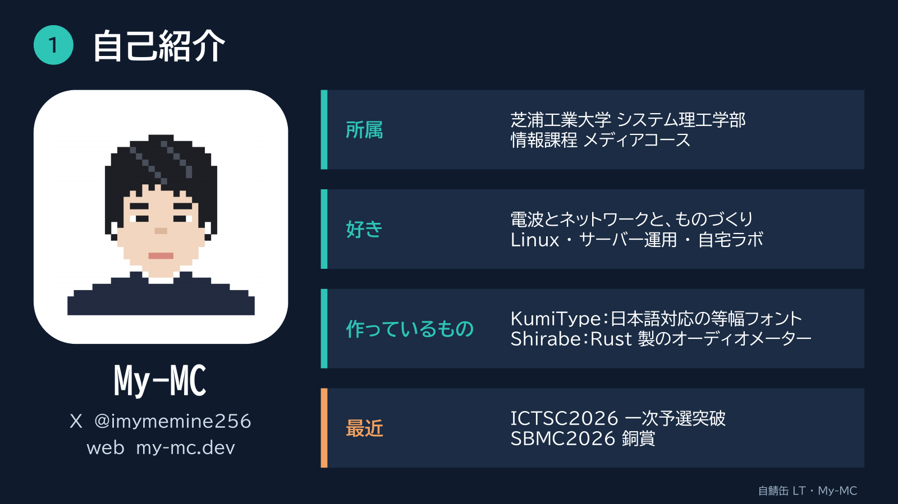
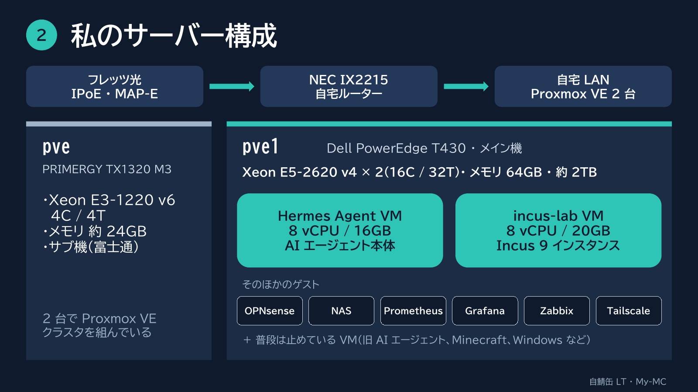
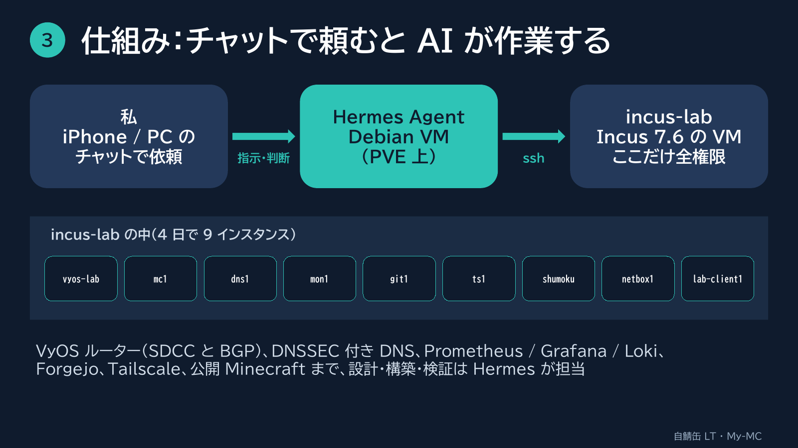
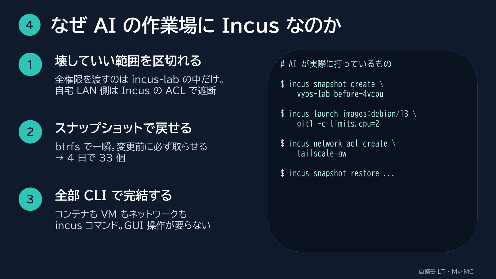
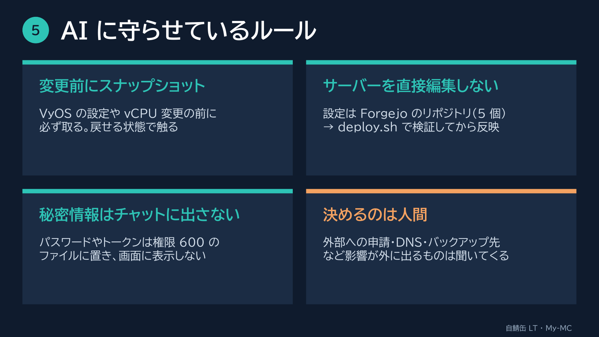
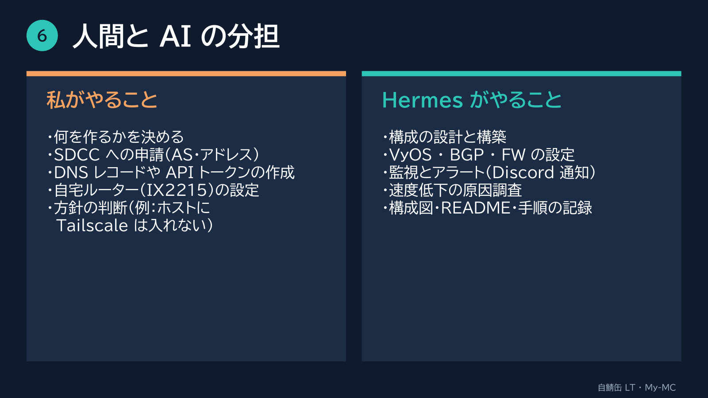
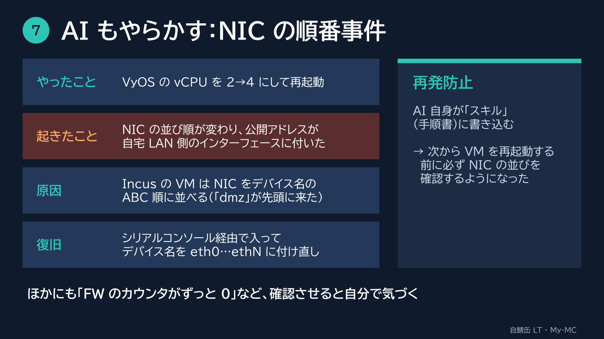
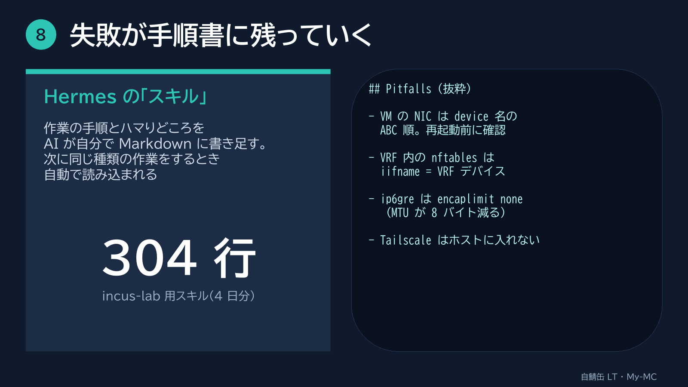
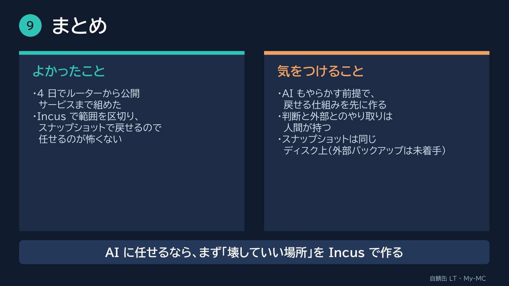

---

title: 自鯖缶のLTで「AIエージェントに自宅ラボを運用させている話」をしました
description: 自鯖缶2026の突発LT（5分）で、Hermes AgentとIncusを使って自宅ラボの構築と運用をAIに任せている話をしました。スライドを公開します。
publishedAt: 2026-11-15T20:00:00+09:00
category: event
tags: [homelab, ai, infra, event]
cover: ../../assets/blog/jisaba-2026-lt/slide-01.png
coverAlt: スライドの表紙「AIエージェントに自宅ラボを運用させている話 Hermes Agent × Incus：任せる範囲をIncusで区切る」
---

自鯖缶2026で突発のLT会（1人5分）があり、飛び入りで発表しました。自宅ラボの構築と運用を、AIエージェントの[Hermes Agent](https://hermes-agent.nousresearch.com/docs)にほぼ任せている話です。

- スライド（PDF）：[jisaba-2026-ai-homelab.pdf](/slides/jisaba-2026-ai-homelab.pdf)

以下、スライドと話した内容です。

## 自己紹介

## 私のサーバー構成

自宅にProxmox VEを2台置いています。メイン機のDell PowerEdge T430に、Hermes Agentを動かすVMと、今回の主役のIncusを動かすVM（incus-lab）が載っています。

## 仕組み

私がチャットで頼むと、別のVMで動いているHermes Agentがincus-labにsshして、`incus`コマンドで作業します。4日で、VyOSのルーター、DNSSEC付きのDNS、監視、Gitサーバー、公開Minecraftサーバーまで9インスタンスになりました。

## なぜAIの作業場にIncusなのか

- **壊していい範囲を区切れる**：全権限を渡すのはincus-labのVMの中だけです
- **スナップショットで戻せる**：btrfsなので一瞬で取れます。変更前に必ず取るルールにしていて、4日で33個になりました
- **全部CLIで完結する**：コンテナもVMもネットワークも`incus`コマンドで扱えるので、AIがそのまま操作できます

## AIに守らせているルール

設定はサーバー上で直接編集せず、Gitリポジトリに置いてデプロイ用のスクリプトで検証してから反映します。外部への申請やDNSなど、影響が外に出ることはAIが勝手に決めずに聞いてきます。

## 人間とAIの分担

## AIもやらかす

速度改善のためにVyOSのVMのvCPUを増やして再起動したら、NICの順番が入れ替わり、公開用のアドレスが自宅LAN側のインターフェースに付いてしまいました。IncusのVMはNICをデバイス名のアルファベット順に並べるのが原因でした。シリアルコンソールから復旧したあと、Hermes自身が手順書に再発防止を書き込み、それ以降は再起動前に必ず確認するようになりました。

## 失敗が手順書に残っていく

Hermes Agentには「スキル」という仕組みがあり、作業の手順やハマりどころをAIが自分でMarkdownに書き足していきます。次に同じ種類の作業をするときに自動で読み込まれます。

## まとめ

AIもやらかす前提で、戻せる仕組みを先に作り、判断と外部とのやり取りは人間が持つ。この分担にしてから、任せるのが怖くなくなりました。

ラボ全体については[自宅ラボ](/projects/homelab/)のページにもまとめています。また、SDCCの皆さんのお力添えをいただき、BGPを勉強させてもらっています。
