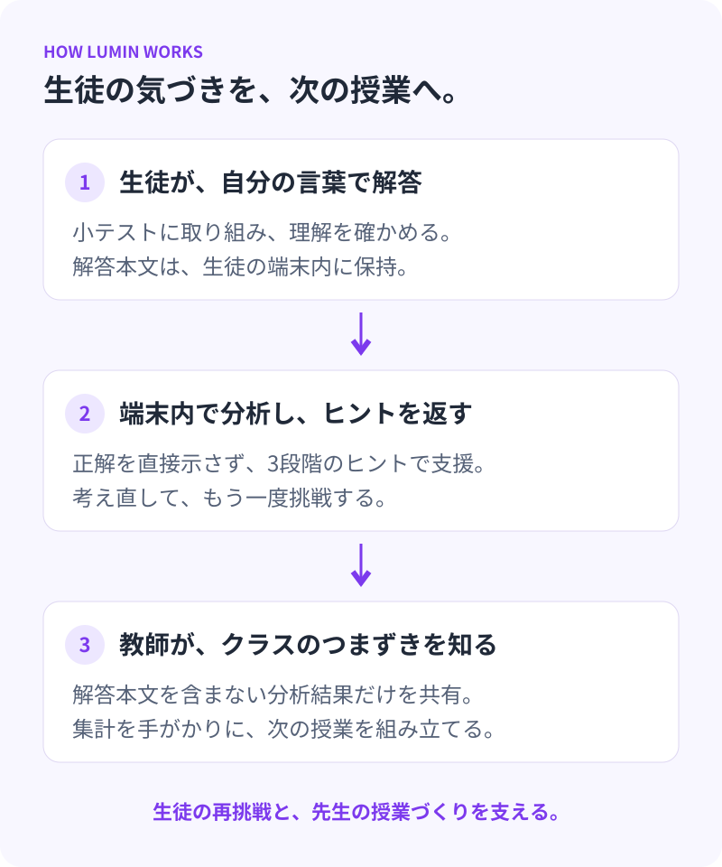
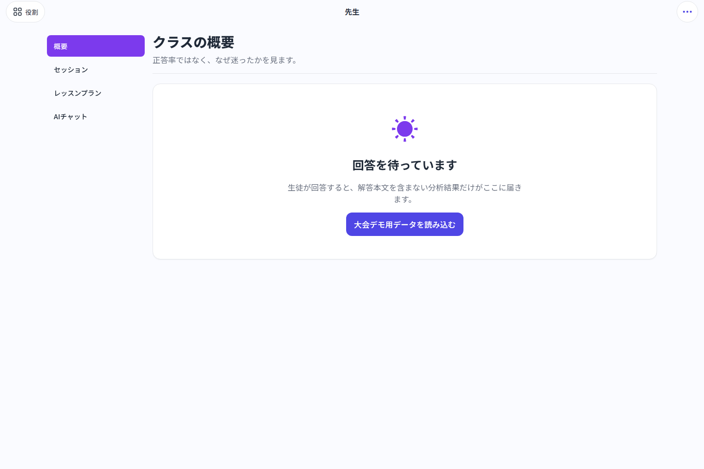

---

title: Lumin
description: 生徒の解答を端末内のAIで分析して段階的なヒントを返し、解答本文を送らずにクラスのつまずきを教師へ共有する学習支援アプリ。SBMCビジネスアイデア部門で銅賞を受賞。
status: active
technologies: [Tauri 2, Rust, React, ONNX Runtime, Gemma, Bun]
tags: [rust, ai]
role: ALG・チーム「Luminous Studying」
award: SBMC 2026 銅賞
repositoryUrl: https://github.com/ALG-SIT/Lumin
cover: ../../assets/lumin/start.png
coverAlt: Luminの起動画面。先生・生徒・デモの3つの役割を選べる。
featured: true
order: 0
---

## 理解を照らし、次の学びにつなげる

Luminは、生徒の解答を**端末内で**分析し、正解を直接示さない3段階のヒントで再挑戦を促す学習支援アプリです。教師には解答本文を送らず、匿名の分析結果だけを共有して、クラス全体のつまずきの傾向と「次の授業の冒頭10分案」を示します。

## 第11回 芝浦ビジネスモデルコンペティションで銅賞

2026年9月27日、豊洲キャンパスで開催された第11回芝浦ビジネスモデルコンペティション（SBMC）ビジネスアイデア部門の最終発表会で、ALGメンバーのチーム「Luminous Studying」が提案したLuminが**銅賞**を受賞しました。今回新設された部門で、12チームの応募から書類審査を通過した6チームが登壇しました。

- [芝浦工業大学の公式記事](https://www.shibaura-it.ac.jp/headline/detail/20260927_7070_2.html)
- [ALG公式サイトの受賞記事](https://alg-sit.club/blog/lumin-sbmc-bronze/)・[プロジェクト紹介](https://alg-sit.club/projects/lumin/)

## 技術的なポイント

ネットワークとオンデバイスAIの両方に関われたのが、自分にとって面白かったところです。

- **教室内ネットワーク**：教師端末が`axum`でHTTPサーバーを立て、生徒端末はDNS-SD（mDNS、`_lumin-class._tcp`）で自動発見して参加。4桁の参加コードで照合し、切断中の結果は端末内キューに保持して再接続時に受領確認つきで再送・重複排除します
- **プライバシーを型で守る**：教師へ送る`AnalysisEvent`は、そもそも解答本文を保持できない型にしています
- **オンデバイスAI**：`ort`（ONNX Runtime）でGemma系モデルを端末内で推論。正答を漏らさないガードと、失敗時のルールベースへのフォールバックを備えています。推論部分は個人で作っていた[gemma-on-device](/projects/gemma-on-device/)の知見を活かしています
- **クロスプラットフォーム**：Tauri 2 + React（Bun / Vite）で、デスクトップとiOSを含むモバイルで動作。CIでmacOS / Windows / Linuxのビルドを検証しています

## 教師ダッシュボード

